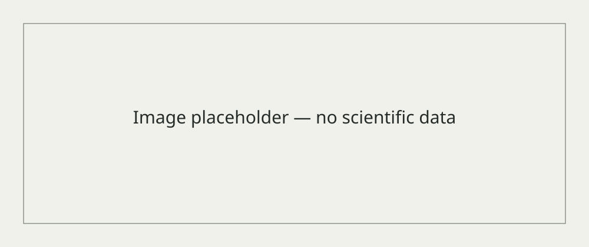

> [!NOTE] Placeholder project
> This example demonstrates documentation structure only. It does not describe real students, a research programme or scientific results.

Title
: **[Project title]**

Research question
: **[Research question]**

Status
: **[Project status]**

Year
: **[Year]**

Supervisor
: **[Supervisor]**

Students
: **[Student or team — no real information supplied]**

## Description

**Placeholder:** Describe the context of the project.

## Objectives

**Placeholder:** State the project objectives.

## Methods

**Placeholder:** Link reviewed methods and explain their role.

## Related protocols

**Placeholder:** Link relevant reviewed protocol records.

## Current outcome

**Placeholder:** Document current results or their absence, with evidence; none are supplied here.

## Next steps

**Placeholder:** Document the planned next steps.

## Related repositories

[Deployment demo repository — example only](https://github.com/ift-biolab/2027-demo-student)

## Student documentation links

[Deployment demo site — example only](https://ift-biolab.github.io/2027-demo-student/)

## Image placeholder

*Replace this neutral image with an approved project image and a descriptive caption.*
{.caption}
